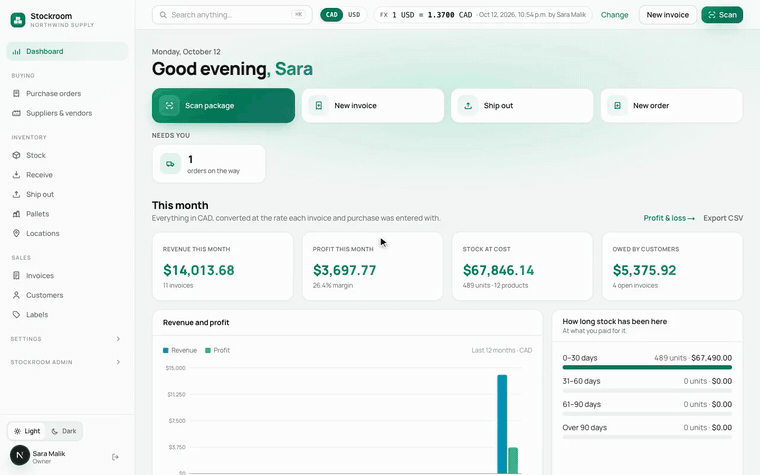
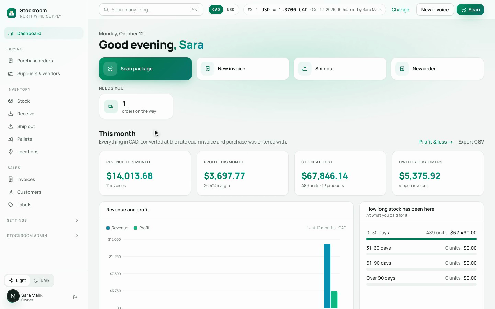
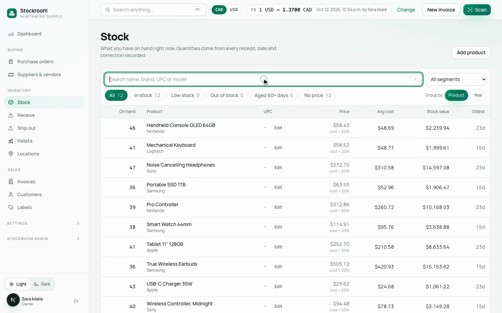
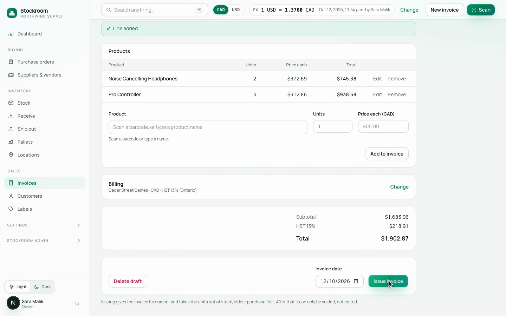
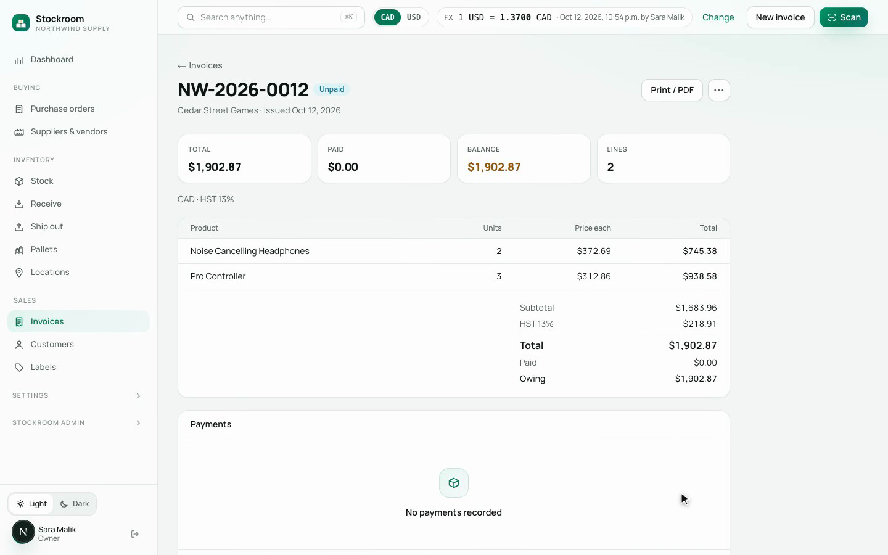
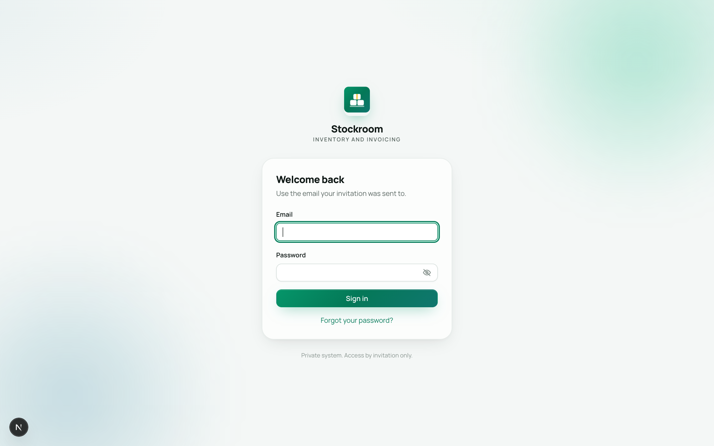

# Stockroom - ERP System for Tech Trove

An internal inventory, purchasing and invoicing system I built for a multi-company electronics distribution business. It tracks every unit from purchase order to delivery to serial number to pallet to customer invoice.

<a href="media/demo.mp4">Watch the full-quality video</a>

## Why I built it

The business was running purchasing, receiving, inventory and invoicing across spreadsheets and a patchwork of tools. Stock counts didn't match what was actually on the shelf, invoices were edited after the fact, and there was no single place to look up a serial number and see its full history. Stockroom replaces all of that with one system built around a simple rule: **stock on hand is never typed in — it's calculated from recorded movements**, and nothing in the ledger can be edited or deleted after the fact.

## What it does

- **Purchasing** — create purchase orders, track suppliers, manage a gift-card wallet, and reconcile spend against bank statements
- **Receiving** — scan items in against an order (UPC, then quantity, then serial numbers), attach photos, flag damage
- **Serial tracking** — every unit has its own history: which supplier it came from, what it cost, which invoice it was sold on
- **Inventory** — a live, movement-based ledger with stock age, value, and location
- **Invoicing** — draft, issue, pay and void invoices, with support for both CAD and USD pricing and Canadian tax rules
- **Logistics** — carton and pallet labels with barcodes, ready for shipping
- **Multiple companies** — each company's data is kept separate, with role-based access per person
- **Mobile** — barcode scanning and on-device text recognition from a phone browser, for use on the warehouse floor

## Screenshots

These come from a demo company filled with sample products and customers, since the live system holds real business data.

**Dashboard**

**Stock levels**

**Building an invoice**

**Issued invoice**

**Sign in**

## Tech used

Next.js, React, TypeScript, and PostgreSQL (via Supabase) with row-level security enforcing company and role permissions directly in the database.

---

This repository is a public overview only. The system holds real business and customer data, so the source code and live instance are private.
